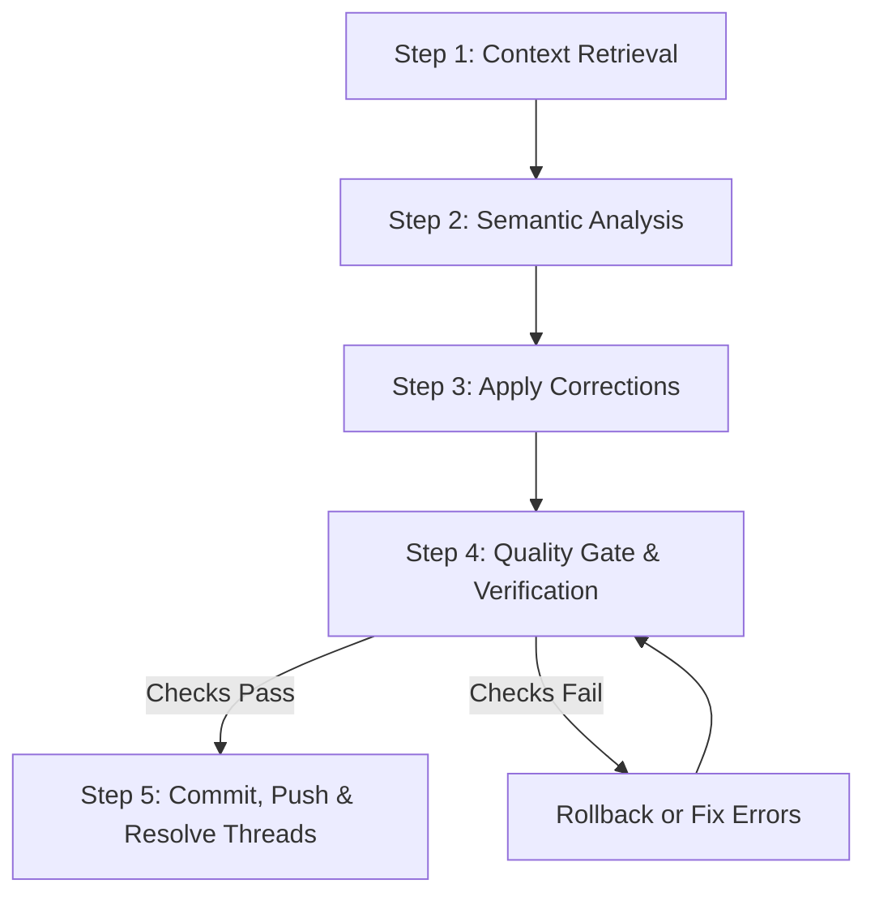

# GitHub PR Review & Auto-Correction

A robust, multi-stage workflow to inspect GitHub Pull Request discussions, parse review suggestions, apply actionable fixes, verify local quality gates (linting & tests), and resolve resolved GitHub review threads.

## Workflow Overview



---

## Step-by-Step Procedure

### Step 1: Context Retrieval

1. Retrieve the pull request diff and metadata via GitHub CLI or MCP server:
   ```bash
   gh pr diff <PR_NUMBER>
   ```
2. Fetch review comments and active threads:
   ```bash
   gh api graphql -F owner=":owner" -F name=":repo" -F prNumber="<PR_NUMBER>" -f query='
     query($owner: String!, $name: String!, $prNumber: Int!) {
       repository(owner: $owner, name: $name) {
         pullRequest(number: $prNumber) {
           reviewThreads(first: 50) {
             nodes {
               id
               isResolved
               comments(first: 10) {
                 nodes {
                   body
                   path
                   line
                   author { login }
                 }
               }
             }
           }
         }
       }
     }
   '
   ```

### Step 2: Semantic Analysis

1. Match each comment to its target file and line numbers.
2. Classify review feedback into:
   - **Actionable Suggestions:** Explicit code suggestions, typo fixes, missing edge case handling, or formatting updates.
   - **Discussion Points:** Open design questions, architecture inquiries, or informational feedback.
3. Prioritize actionable items based on importance and risk.

### Step 3: Apply Corrections

1. Edit the relevant local files matching the agreed suggestions.
2. Keep edits focused: do not refactor unrelated sections or overwrite existing docstrings unless requested.

### Step 4: Quality Gate & Verification

Run project-specific linting, formatting, and unit test suites before staging changes:
```bash
# Example verification checks
uv run ruff check .
pytest
```
- **If checks fail:** Diagnose errors, apply corrective fixes, and re-run verification until 100% passing.
- **If checks succeed:** Proceed to resolution.

### Step 5: Commit, Push & Resolve Threads

1. Stage and commit verified changes:
   ```bash
   git add <modified-files>
   git commit -m "fix(review): address PR review comments"
   git push origin <branch-name>
   ```
2. Resolve corresponding GitHub review threads using GraphQL:
   ```bash
   gh api graphql -F threadId="<THREAD_NODE_ID>" -f query='
     mutation($threadId: ID!) {
       resolveReviewThread(input: {threadId: $threadId}) {
         thread { id isResolved }
       }
     }
   '
   ```
3. Post a concise summary on the PR highlighting what was changed and resolved.
