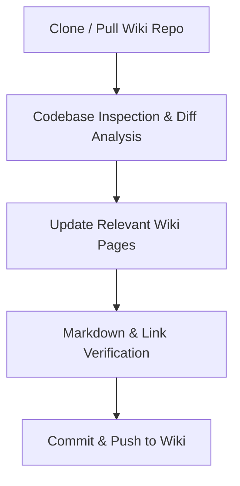

# Sync Project Wiki

A standardized workflow to inspect the current codebase for recent modifications across services, API routes, models, and configuration, and synchronize the corresponding documentation in the project's GitHub Wiki repository (`<REPO>.wiki.git`).

---

## Workflow Overview



---

## Step-by-Step Procedure

### Step 1: Clone or Update Wiki Repository

1. Locate or create a temporary working directory (e.g., in temp or scratch directory):
2. Clone if not present, or pull latest changes:
   ```bash
   # If not cloned yet
   git clone https://github.com/<OWNER>/<REPO>.wiki.git <wiki_path>

   # If already cloned
   cd <wiki_path>
   git pull origin master
   ```

### Step 2: Codebase Inspection & Change Detection

Inspect project components for recent updates:
1. **API & Endpoints:** Identify added, deprecated, or modified routes, payloads, and response structures.
2. **Architecture & Services:** Check agent layers, background tasks, or workflow orchestrations.
3. **Database Schema:** Check model files and migration scripts for added/modified tables and fields.
4. **Configuration & Integrations:** Review environment variables, third-party SDKs, and deployment configs.

### Step 3: Update Relevant Wiki Pages

Map discovered changes to the corresponding wiki pages:

| Wiki Page | Content Scope | Update Triggers |
| :--- | :--- | :--- |
| **`Home.md`** | High-level summary, features, repository structure, sitemap | Major feature releases or repo layout reorganization |
| **`_Sidebar.md`** | Global navigation bar across wiki pages | New pages created or page titles changed |
| **`Architecture.md`** | High-level system architecture, component diagrams, ERD | New components, data flows, or schema changes |
| **`API-Reference.md`** | REST / GraphQL endpoint documentation and auth | Route changes, request/response schema changes |
| **`Setup-and-Deployment.md`** | Environment variables, prerequisites, Docker, CI/CD | Dependency or configuration changes |

### Step 4: Quality & Markdown Verification

1. **GitHub-Flavored Markdown:** Ensure proper syntax for tables, code fences, and alerts.
2. **Mermaid Diagrams:** Validate diagram blocks (e.g. `flowchart TD`, `sequenceDiagram`) for valid syntax.
3. **Wiki Relative Links:** Use standard wiki link formatting (e.g. `[Architecture](Architecture)`).
4. **Clean Worktree:** Ensure no temporary scratch files or secrets are staged.

### Step 5: Commit & Push Changes

```bash
cd <wiki_path>
git status
git add .
git commit -m "docs(wiki): update documentation to match codebase state"
git push origin master
```
